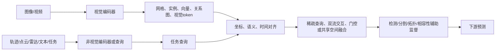
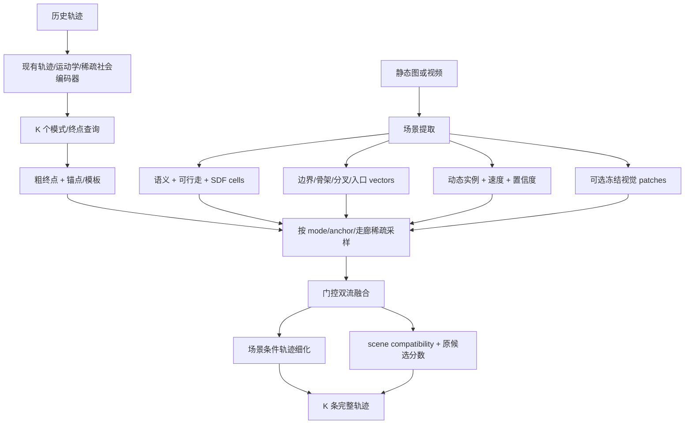

# 跨领域视觉场景提取与多模态融合调研

> 副标题：自动驾驶、目标检测/分割、视频理解与通用多模态模型对行人轨迹预测的启示  
> 检索日期：2026-08-28  
> 主要时间范围：2022—2025 年已正式公开的顶会/顶刊论文；2026 年会议周期尚未完整，不把未核验预印本作为核心证据  
> 配套报告：[近四年场景信息提取与轨迹融合深度调研](./近四年场景信息提取与轨迹融合深度调研_2026-08-28.md)  
> 当前模型参照：轨迹与稀疏社会交互编码 + 运动学先验 + K 个模式/锚点查询 + 候选生成、评分与细化体系  
> 说明：本报告研究的是可迁移的表示与融合机制。自动驾驶检测 AP、地图 mAP、视频分类准确率不能换算为 SDD 的 ADE/FDE 改善幅度。

---

## 1. 为什么必须看轨迹预测之外的领域

行人轨迹预测中的“场景分支”经常被简化成 `CNN(image) -> global vector -> concat`。但在自动驾驶感知、目标检测、视频理解和视觉语言模型中，视觉与其他数据的融合已经经历了更系统的演化：

1. 从**原始输入拼接**转向**坐标对齐后的特征融合**；
2. 从整图单向量转向**BEV 网格、实例、向量、关系图和少量查询 token**；
3. 从一次融合转向**分层、双向、迭代融合**；
4. 从默认所有模态可靠转向**可靠性门控、模态丢弃和多专家**；
5. 从端到端训练全部大模型转向**冻结视觉基础模型 + 小型桥接器**或**教师蒸馏**；
6. 从视觉“提供额外特征”转向视觉直接回答下游任务的查询，例如“该候选终点附近是否可通行”“该路径走廊中有什么障碍”。

这些变化恰好对应当前模型加入场景时最容易遇到的四个问题：视觉与轨迹坐标不一致、整图信息被压扁、视觉支路在训练中被忽略、视觉噪声破坏原有运动学与社会交互表示。

---

## 2. 跨领域共同结论

### 2.1 最重要的八个判断

1. **对齐先于融合。** DeepFusion 在数据增强后恢复点云—图像几何对应，CMT 使用共享 3D 位置编码，BEVFusion 把相机与 LiDAR 映射到共同 BEV。对当前模型，这意味着必须把场景特征转换到与轨迹相同的世界/像素坐标，并显式编码相对目标的位置和方向。

2. **下游查询应主动读取视觉，而不是被动接收整图向量。** TransFusion、FUTR3D、RaCFormer、BLIP-2 都让少量对象/任务查询从大量视觉特征中取信息。当前 K 个模式查询或锚点查询天然适合扮演这个角色。

3. **可靠模态产生粗提议，视觉负责补充语义和修正。** TransFusion 先由 LiDAR 查询给出粗框，再读取图像；对轨迹模型，可先由历史、运动学和社会交互生成候选，再由场景修正终点、锚点、走廊和分数，而不是让图像从零替代轨迹生成。

4. **不要过早坍缩模态。** DeepInteraction 保留相机和 LiDAR 两套表示并多次交互；IS-Fusion 同时保留场景级和实例级表示。当前也应保留“轨迹/运动学流”和“场景流”，只在 mode、anchor、refinement、scoring 接口处交互。

5. **场景需要多粒度。** Dense grid 保存可行走边界，instance token 保存动态目标，vector/graph 保存拓扑，global token 保存全局环境。单一形式无法同时解决终点选择、路径分叉和局部避障。

6. **视频的价值不是重复编码多帧，而是提取变化。** Deformable Video Transformer 用运动线索指导时空稀疏采样，MapTracker 和 BEVFormer维护时序记忆，PVC 只补充前帧未表达的新信息。固定摄像机 SDD 尤其适合“静态参考图 + 动态残差/对象”的分解。

7. **重型视觉模型可以只做教师或离线预处理。** SupFusion、CRKD、MapDistill 证明跨模态知识可以经辅助监督或蒸馏进入轻模型；BLIP-2 证明冻结大视觉编码器并只训练桥接器是可行范式。当前阶段即使不考虑开销，也应保留这条可部署路径。

8. **缺失或低质量视觉必须被显式处理。** MoME、SAMFusion、TransFusion 均考虑模态失效或可见性变化。场景支路应支持 scene dropout、置信门和零初始化残差，确保没有可靠图像时退化回原轨迹模型，而不是整体崩溃。

### 2.2 一个统一抽象

不同领域看似输入不同，实际上可以归纳为同一流程：

对于当前模型：`非视觉输入 = 历史轨迹 + 社会交互 + 运动学先验`，`任务查询 = K 个模式/终点/锚点/候选轨迹`，`下游预测 = 完整未来轨迹与候选分数`。

---

## 3. 自动驾驶多传感器感知：图像如何与 LiDAR、雷达和时间融合

### 3.1 共享 BEV：先统一几何坐标，再融合语义

| 论文 | 输入 | 场景表示与融合 | 对当前模型的启示 |
|---|---|---|---|
| [BEVFusion, NeurIPS 2022](https://papers.neurips.cc/paper_files/paper/2022/hash/43d2b7fbee8431f7cef0d0afed51c691-Abstract-Conference.html) | 多相机 + LiDAR | 各模态独立编码并投影到共享 BEV 后融合 | 轨迹坐标和图像坐标必须进入共同局部平面；共享空间是融合前提 |
| [BEVFormer, ECCV 2022](https://www.ecva.net/papers/eccv_2022/papers_ECCV/papers/136690001.pdf) | 多相机 + 历史帧 | BEV queries 通过空间交叉注意力从相机取特征，并用时序自注意力融合历史 BEV | 可用 agent/mode query 定点读取场景，并维护场景记忆而非堆叠视频帧 |
| [Scene as Occupancy, ICCV 2023](https://openaccess.thecvf.com/content/ICCV2023/html/Tong_Scene_as_Occupancy_ICCV_2023_paper.html) | 多视图图像 + 时间 | 把 3D 场景离散为带语义的 occupancy 网格，供检测、分割与规划复用 | SDD 可将二维可行走性、动态占用和语义统一为 scene cells，但无需完整 3D |
| [CRN, ICCV 2023](https://openaccess.thecvf.com/content/ICCV2023/html/Kim_CRN_Camera_Radar_Net_for_Accurate_Robust_Efficient_3D_Perception_ICCV_2023_paper.html) | 相机 + 雷达 + 多帧 | 雷达辅助图像到 BEV 的转换，deformable attention 处理对齐并累积时间信息 | 稀疏动态目标/运动线索可以引导从图像中取哪些区域，而不是全图等权 |
| [RCBEVDet, CVPR 2024](https://openaccess.thecvf.com/content/CVPR2024/html/Lin_RCBEVDet_Radar-camera_Fusion_in_Birds_Eye_View_for_3D_Object_CVPR_2024_paper.html) | 相机 + 雷达 | 雷达点/Transformer 双流，deformable cross-attention 对齐雷达与相机 BEV | 可将动态对象流和静态语义流分开，再用位置驱动的变形采样融合 |
| [GAFusion, CVPR 2024](https://openaccess.thecvf.com/content/CVPR2024/html/Li_GAFusion_Adaptive_Fusing_LiDAR_and_Camera_with_Multiple_Guidance_for_CVPR_2024_paper.html) | 相机 + LiDAR + 历史 | 深度与 occupancy 引导视觉体素，多尺度全局自适应融合并使用历史帧 | 场景分支不应只有一种尺度；几何先验可以引导视觉提取而非在末端拼接 |

**可迁移结论：** SDD 的固定鸟瞰视角比车载多相机更简单，不需要复杂 lift-splat。但应借用 BEV 思想：把图像特征、语义图、轨迹、锚点和候选路径统一到同一局部平面，并保留坐标到 token 的可逆映射。

### 3.2 查询式融合：只读取与当前对象/候选有关的视觉

| 论文 | 核心机制 | 对当前模型的直接映射 |
|---|---|---|
| [TransFusion, CVPR 2022](https://openaccess.thecvf.com/content/CVPR2022/html/Bai_TransFusion_Robust_LiDAR-Camera_Fusion_for_3D_Object_Detection_With_Transformers_CVPR_2022_paper.html) | 第一层从 LiDAR 查询产生粗检测；第二层通过软关联读取相关图像特征 | 先用现有轨迹模型生成 K 个粗终点/锚点，再按候选位置与方向读取场景，输出偏移和 scene score |
| [FUTR3D, CVPRW 2023](https://openaccess.thecvf.com/content/CVPR2023W/WAD/html/Chen_FUTR3D_A_Unified_Sensor_Fusion_Framework_for_3D_Detection_CVPRW_2023_paper.html) | 模态无关采样器让对象查询从相机、LiDAR、雷达分别取样 | 一个 mode query 可分别读取语义网格、视觉 patch、动态对象和行为走廊，再在 query 内融合 |
| [CMT, ICCV 2023](https://openaccess.thecvf.com/content/ICCV2023/html/Yan_Cross_Modal_Transformer_Towards_Fast_and_Robust_3D_Object_Detection_ICCV_2023_paper.html) | 不显式做视角转换；通过共享 3D 位置编码对齐图像与点云 token | 若已有可靠单应性，可直接给轨迹/scene token 使用共享相对位置编码，避免构造很大的 dense BEV feature |
| [RaCFormer, CVPR 2025](https://openaccess.thecvf.com/content/CVPR2025/html/Chu_RaCFormer_Towards_High-Quality_3D_Object_Detection_via_Query-based_Radar-Camera_Fusion_CVPR_2025_paper.html) | 查询在 BEV 和原图视角中自适应采样，采样分布随距离变化 | 近处路径需要高分辨率局部语义，远期终点需要更宽区域；采样范围可随预测时间/锚点距离扩大 |

这一类方法是本次跨领域调研中**最适合当前模型**的机制。它不要求推翻已有编码器和稀疏注意力，只需要把 `mode/anchor/candidate` 变成 scene query。

### 3.3 双流与实例—场景协作：不要一次性把模态压成一个张量

| 论文 | 核心机制 | 可迁移部分 |
|---|---|---|
| [DeepInteraction, NeurIPS 2022](https://papers.nips.cc/paper_files/paper/2022/hash/0d18ab3b5fabfa6fe47c62e711af02f0-Abstract-Conference.html) | 全程保留模态专属表示，通过多模态表征交互编码器和预测交互解码器反复交换信息 | 保留轨迹/运动学流和视觉场景流；可在 mode 生成、anchor 修正、refinement、scoring 四处逐层交互 |
| [SparseFusion, ICCV 2023](https://openaccess.thecvf.com/content/ICCV2023/html/Xie_SparseFusion_Fusing_Multi-Modal_Sparse_Representations_for_Multi-Sensor_3D_Object_Detection_ICCV_2023_paper.html) | 两个模态都先形成稀疏候选，再分开传递语义与几何信息 | 场景不必保留全部像素；可形成入口、分叉、障碍边界、动态对象等少量候选 token |
| [IS-Fusion, CVPR 2024](https://openaccess.thecvf.com/content/CVPR2024/html/Yin_IS-Fusion_Instance-Scene_Collaborative_Fusion_for_Multimodal_3D_Object_Detection_CVPR_2024_paper.html) | 分层 scene fusion 获得区域表示；instance-guided fusion 挖掘对象和对象关系；instance-to-scene attention 再把实例信息反馈给场景 | 构建“场景 cells/regions”与“行人/mode instances”双层图；允许行人查询场景，也允许群体状态更新局部动态场景表示 |
| [CamLiFlow, CVPR 2022](https://openaccess.thecvf.com/content/CVPR2022/html/Liu_CamLiFlow_Bidirectional_Camera-LiDAR_Fusion_for_Joint_Optical_Flow_and_Scene_CVPR_2022_paper.html) | 相机与 LiDAR 双向融合，共同估计 optical flow 与 scene flow | 视觉运动和坐标轨迹可互相校正；视频光流不应只作为额外通道被动拼接 |

### 3.4 可靠性门控、模态缺失与教师蒸馏

| 论文 | 核心机制 | 对当前模型的意义 |
|---|---|---|
| [TransFusion, CVPR 2022](https://openaccess.thecvf.com/content/CVPR2022/html/Bai_TransFusion_Robust_LiDAR-Camera_Fusion_for_3D_Object_Detection_With_Transformers_CVPR_2022_paper.html) | 软关联提高图像退化、错位和相机缺失下鲁棒性 | query-scene 注意力要允许“不读取场景”，不能强制每个候选依赖图像 |
| [SAMFusion, ECCV 2024](https://mlanthology.org/eccv/2024/palladin2024eccv-samfusion/) | 按距离、可见性和传感器状态自适应加权 RGB、LiDAR、NIR、雷达 | 用 scene confidence、遮挡和 crop 有效比例控制融合强度 |
| [MoME, CVPR 2025](https://openaccess.thecvf.com/content/CVPR2025/html/Park_Resilient_Sensor_Fusion_Under_Adverse_Sensor_Failures_via_Multi-Modal_Expert_CVPR_2025_paper.html) | camera-only、LiDAR-only、fusion 三个解码专家，解除强制模态依赖 | 可设置 trajectory-only 与 trajectory+scene 两个专家，由门控选择；scene dropout 训练确保回退能力 |
| [SupFusion, ICCV 2023](https://openaccess.thecvf.com/content/ICCV2023/html/Qin_SupFusion_Supervised_LiDAR-Camera_Fusion_for_3D_Object_Detection_ICCV_2023_paper.html) | 教师提供特征级辅助监督，插件式且推理不增开销 | 重型场景教师监督小型 scene adapter，使视觉支路学到任务相关信息而非被忽略 |
| [CRKD, CVPR 2024](https://openaccess.thecvf.com/content/CVPR2024/html/Zhao_CRKD_Enhanced_Camera-Radar_Object_Detection_with_Cross-modality_Knowledge_Distillation_CVPR_2024_paper.html) | 在共享 BEV 中从强 LiDAR-camera 教师向 camera-radar 学生蒸馏多层知识 | 可从强语义/视觉教师向纯轨迹或轻场景模型蒸馏模式概率、scene compatibility 和候选排序 |
| [MapDistill, ECCV 2024](https://www.ecva.net/papers/eccv_2024/papers_ECCV/html/358_ECCV_2024_paper.php) | camera-LiDAR 地图教师向轻量 camera-only 学生做关系、特征和 head 蒸馏 | 可离线用完整语义图/大视觉 backbone 训练 teacher，部署时只保留压缩场景 token 或行为场 |

---

## 4. 自动驾驶地图与规划：如何把像素场景变成可推理的结构

### 4.1 从栅格到向量、集合和拓扑

| 论文 | 场景提取/表示 | 融合或使用方式 | 对行人场景的迁移 |
|---|---|---|---|
| [MapTR, ICLR 2023](https://mlanthology.org/iclr/2023/liao2023iclr-maptr/) | 相机图像端到端生成矢量地图；地图元素作为点集，使用层级查询与置换等价建模 | 输出车道分隔线、边界等结构元素 | 把人行道边界、建筑边界、通道中心线、入口/出口建成矢量 point sets，避免整图栅格注意力 |
| [VAD, ICCV 2023](https://openaccess.thecvf.com/content/ICCV2023/html/Jiang_VAD_Vectorized_Scene_Representation_for_Efficient_Autonomous_Driving_ICCV_2023_paper.html) | agent、lane、boundary、ego 全部矢量化 | 直接作为规划约束和指导，避免密集 raster | 当前轨迹本来就是向量；将 scene 也向量化后，轨迹—场景可用同类相对几何编码 |
| [Mask2Map, ECCV 2024](https://eccv.ecva.net/virtual/2024/poster/247) | 先生成 BEV 实例级语义 mask，再从 mask-aware query 提取位置和稀疏关键点，生成矢量地图 | mask 与 vector 两阶段保持一致性并加去噪训练 | **非常适合 SDD**：先离线分割可行走/建筑等区域，再从 mask 提取边界、骨架、分叉和入口 token |
| [GeMap, ECCV 2024](https://eccv.ecva.net/virtual/2024/poster/2473) | 显式学习地图实例的欧式形状和关系；几何 loss 使用角度和幅值，解耦 self-attention 分别处理形状与关系 | 强化平行、垂直等几何关系 | 行人场景可监督通道连续性、分叉角、边界距离；场景几何和语义关系可分头编码 |
| [MapQR, ECCV 2024](https://eccv.ecva.net/virtual/2024/poster/2472) | 内容与位置解耦的 scatter-and-gather query；散到参考点读 BEV，再聚回地图实例 | 强化单个结构实例内部信息 | 一个候选路径可把查询散到终点/多个锚点/中间步，读取局部场景后再聚合为候选表示 |
| [MapTracker, ECCV 2024](https://eccv.ecva.net/virtual/2024/poster/136) | 同时维护 BEV raster memory 与 vector memory，并传播历史查询 | 以 tracking 方式保持地图时序一致 | 对视频场景同时维护动态 occupancy memory 与稳定静态拓扑 memory，无需每帧重建整个场景 |

### 4.2 从感知到预测/规划的“查询接口”

| 论文 | 机制 | 启示 |
|---|---|---|
| [UniAD, CVPR 2023](https://openaccess.thecvf.com/content/CVPR2023/html/Hu_Planning-Oriented_Autonomous_Driving_CVPR_2023_paper.html) | 检测、跟踪、地图、运动预测、占用和规划通过统一 query 接口通信，并面向最终规划共同优化 | 场景分割不是独立终点；应由轨迹损失反向决定哪些 scene token 有用，同时保留可解释辅助任务 |
| [VAD, ICCV 2023](https://openaccess.thecvf.com/content/ICCV2023/html/Jiang_VAD_Vectorized_Scene_Representation_for_Efficient_Autonomous_Driving_ICCV_2023_paper.html) | 矢量场景元素直接形成规划的实例级约束 | 当前候选 scorer 可直接读取“与边界/通道/动态对象的相对关系”，不必只读视觉 embedding |
| [From Pixels to Graphs, CVPR 2024](https://openaccess.thecvf.com/content/CVPR2024/html/Li_From_Pixels_to_Graphs_Open-Vocabulary_Scene_Graph_Generation_with_Vision-Language_CVPR_2024_paper.html) | VLM 将图像生成对象—关系场景图，并通过显式关系帮助下游视觉语言任务 | 可离线产生 `pedestrian-near-entrance`、`path-blocked-by-vehicle` 等关系图；适合作为教师/辅助标签，不宜首轮在线生成 |

**核心判断：** 对 SDD，场景的最佳在线表示很可能不是纯 raster，也不是纯 vector，而是：

- 低分辨率语义/可行走 raster，保存连续边界和 SDF；
- 少量 topology/vector tokens，保存通道、分叉、入口和出口；
- dynamic instance tokens，保存车辆、自行车和临时障碍；
- K 个 mode/anchor queries 按需读取以上三类信息。

---

## 5. 目标检测与分割：从图片中提取什么场景信息

### 5.1 通用分割：语义、实例和边界

| 论文 | 能提取的内容 | 对当前项目的使用建议 |
|---|---|---|
| [Mask2Former, CVPR 2022](https://openaccess.thecvf.com/content/CVPR2022/html/Cheng_Masked-Attention_Mask_Transformer_for_Universal_Image_Segmentation_CVPR_2022_paper.html) | 以 masked attention 和 queries 统一语义、实例、全景分割 | 适合离线生成稳定的地面/建筑/植被/对象 mask，并保留 query-level 区域表示 |
| [OneFormer, CVPR 2023](https://openaccess.thecvf.com/content/CVPR2023/html/Jain_OneFormer_One_Transformer_To_Rule_Universal_Image_Segmentation_CVPR_2023_paper.html) | task token 条件化同一模型完成 semantic/instance/panoptic segmentation；query-text 对比学习增强类别区分 | 可同时取得静态语义和动态实例，并用任务 token 指定“可行走/障碍/入口”等任务 |
| [Segment Anything, ICCV 2023](https://openaccess.thecvf.com/content/ICCV2023/html/Kirillov_Segment_Anything_ICCV_2023_paper.html) | promptable class-agnostic masks，跨分布零样本迁移 | 适合离线细化边界、生成对象区域；本身不提供可靠语义类别，必须与检测/文本模型组合 |
| [SegGPT, ICCV 2023](https://openaccess.thecvf.com/content/ICCV2023/html/Wang_SegGPT_Towards_Segmenting_Everything_in_Context_ICCV_2023_paper.html) | 将多种分割任务统一为 in-context coloring，可处理图像与视频 | 可用少量 SDD 场景示例定义自有类别，如台阶、入口、不可通行草坪 |
| [SAM 2, ICLR 2025](https://proceedings.iclr.cc/paper_files/paper/2025/hash/45c1f6a8cbf2da59ebf2c802b4f742cd-Abstract-Conference.html) | 图像/视频统一 promptable segmentation，并利用流式记忆追踪对象 | 若使用视频流，适合将车辆、自行车、群体和临时障碍跨帧保持为一致实例 |

### 5.2 开放词汇检测与语言条件场景解析

| 论文 | 融合方式 | 对场景提取的价值 |
|---|---|---|
| [GLIP, CVPR 2022](https://openaccess.thecvf.com/content/CVPR2022/html/Li_Grounded_Language-Image_Pre-Training_CVPR_2022_paper.html) | 将目标检测与短语 grounding 统一，深度融合图像与文本 | 无需固定 COCO 类别，可用文本查询入口、路障、车辆、自行车、台阶、草坪等任务对象 |
| [X-Decoder, CVPR 2023](https://openaccess.thecvf.com/content/CVPR2023/html/Zou_Generalized_Decoding_for_Pixel_Image_and_Language_CVPR_2023_paper.html) | 通用非语义 queries 与文本诱导语义 queries 共用像素—语言空间 | 同时获得无类别区域和任务相关语义 mask，适合制作 SDD 离线场景标注 |
| [Grounding DINO, ECCV 2024](https://www.ecva.net/papers/eccv_2024/papers_ECCV/papers/06319.pdf) | 跨模态融合实现文本条件开放集检测 | 与 SAM/SAM2 组合可形成“文本找对象—mask 精确分割—视频跟踪”的离线流水线 |
| [YOLO-World, CVPR 2024](https://openaccess.thecvf.com/content/CVPR2024/html/Cheng_YOLO-World_Real-Time_Open-Vocabulary_Object_Detection_CVPR_2024_paper.html) | RepVL-PAN 在检测骨干中融合语言，region-text 对比预训练 | 若后期需要在线动态障碍检测，是 Grounding DINO 的高效替代方向；可自定义任务词表 |
| [From Pixels to Graphs, CVPR 2024](https://openaccess.thecvf.com/content/CVPR2024/html/Li_From_Pixels_to_Graphs_Open-Vocabulary_Scene_Graph_Generation_with_Vision-Language_CVPR_2024_paper.html) | image-to-graph 序列生成，输出开放词汇对象与关系 | 能补充“谁与谁、谁靠近哪里、什么阻挡什么”，但关系噪声高，建议只做弱标签或 teacher |

### 5.3 目标识别领域给出的重要提醒

1. **SAM 只解决“区域在哪里”，不自动解决“这个区域对行人意味着什么”。** 必须配合语义分类、开放词汇检测或人工/轨迹统计标签。
2. **开放词汇并不等于任务相关。** “树”“草地”“道路”只是视觉类别；模型还需学习这些类别相对当前行人的可通行性和目标吸引力。
3. **实例级与语义级都需要。** 建筑/道路适合语义图，车辆/自行车适合实例 token；把所有东西压成同一语义 mask 会丢失动态对象身份。
4. **场景关系适合辅助监督。** 关系图可以指导 mode 分类和 scorer，但直接把生成式文本关系作为硬约束风险较大。

---

## 6. 视频理解：如何提取动态场景而不被大量帧淹没

### 6.1 时空局部性、运动引导与记忆

| 论文 | 视频特征提取机制 | 对 SDD/行人视频的迁移 |
|---|---|---|
| [Video Swin Transformer, CVPR 2022](https://openaccess.thecvf.com/content/CVPR2022/html/Liu_Video_Swin_Transformer_CVPR_2022_paper.html) | 局部 3D 时空窗口和 shifted windows，利用图像预训练 | 只在局部空间和短时间内建模视觉变化，适合围绕目标/走廊 crop；不必做全视频全局注意力 |
| [Deformable Video Transformer, CVPR 2022](https://openaccess.thecvf.com/content/CVPR2022/html/Wang_Deformable_Video_Transformer_CVPR_2022_paper.html) | 使用压缩视频中的运动线索，动态选择少量跨帧 patch 做 deformable attention | 用轨迹、光流或候选路径指导视频 patch 采样；与现有稀疏注意力思想一致 |
| [DEVA, ICCV 2023](https://openaccess.thecvf.com/content/ICCV2023/html/Cheng_Tracking_Anything_with_Decoupled_Video_Segmentation_ICCV_2023_paper.html) | 图像级任务模型与通用双向时序传播解耦，融合多帧分割假设 | 可先用静态图像模型识别对象/区域，再用轻量传播维护视频一致性，不必重训端到端视频分割器 |
| [SAM 2, ICLR 2025](https://proceedings.iclr.cc/paper_files/paper/2025/hash/45c1f6a8cbf2da59ebf2c802b4f742cd-Abstract-Conference.html) | 流式记忆支持视频对象分割和持续追踪 | 提取临时障碍和动态目标 mask，形成动态 scene memory |
| [MapTracker, ECCV 2024](https://eccv.ecva.net/virtual/2024/poster/136) | raster 与 vector 双记忆、历史 query 传播、按距离步长选取记忆 | 静态拓扑低频更新，动态占用高频更新；视频分支可只编码变化部分 |

### 6.2 视觉 token 压缩与任务条件读取

| 论文 | 压缩/桥接机制 | 对当前模型的启示 |
|---|---|---|
| [Flamingo, NeurIPS 2022](https://proceedings.neurips.cc/paper_files/paper/2022/hash/960a172bc7fbf0177ccccbb411a7d800-Abstract-Conference.html) | Perceiver Resampler 将可变长度视觉特征压成固定数量 token；gated cross-attention 注入冻结语言模型 | 用 8—32 个 scene latent 压缩局部视觉，以零/小门控注入冻结或预训练好的轨迹骨干 |
| [BLIP-2, ICML 2023](https://proceedings.mlr.press/v202/li23q.html) | 冻结图像编码器和语言模型，由轻量 Q-Former 查询视觉并桥接模态 | 用 trajectory/mode-conditioned Q-Former 从冻结视觉 backbone 取任务相关场景信息；不是简单全局池化 |
| [LookupViT, ECCV 2024](https://eccv.ecva.net/virtual/2024/poster/760) | 高分辨率 token 与少量压缩 token 双向 cross-attention；只重计算少量 token | 可保留高分辨率边界供局部采样，同时用少量 global scene tokens 处理全局分叉信息 |
| [LLaMA-VID, ECCV 2024](https://www.ecva.net/papers/eccv_2024/papers_ECCV/html/6290_ECCV_2024_paper.php) | 每帧压为 content token 与由用户查询条件化的 context token | 每帧可拆成“场景变化 token”和“由目标轨迹/mode 条件化的局部 context token” |
| [PVC, CVPR 2025](https://openaccess.thecvf.com/content/CVPR2025/html/Yang_PVC_Progressive_Visual_Token_Compression_for_Unified_Image_and_Video_CVPR_2025_paper.html) | 逐帧编码并自适应压缩，只补充此前帧未提取的信息，利用视频时间冗余 | 固定摄像机场景只需保存参考图，后续帧编码动态差异；避免重复输入同一静态背景 |
| [Dynamic-VLM, ICCV 2025](https://openaccess.thecvf.com/content/ICCV2025/html/Wang_Dynamic-VLM_Simple_Dynamic_Visual_Token_Compression_for_VideoLLM_ICCV_2025_paper.html) | 动态视觉 token 压缩，在长视频中自适应平衡信息和开销 | 未来若使用较长视频窗口，可按运动/轨迹相关性动态保留 token |

### 6.3 视频支路究竟应提取什么

对固定摄像机行人数据，不建议把完整 RGB 视频直接送入大视频 Transformer。更合理的是分解为：

- **静态背景**：参考图上的语义、SDF、边界、入口/出口、拓扑，只算一次；
- **动态实例**：车辆、自行车、群体、临时障碍的 mask、中心、速度和类别；
- **局部运动残差**：光流或 feature difference，只在目标和候选走廊附近采样；
- **可见性/置信度**：遮挡、模糊、目标是否在图像有效区域；
- **短期行为线索**：姿态、朝向、起步/停留等，可作为辅助而不是主预测变量。

这种分解比“每帧整图特征拼接”更可解释，也更容易判断到底是哪一类场景信息改善了 ADE/FDE。

---

## 7. 通用多模态模型：视觉与其他数据如何建立桥梁

### 7.1 三种值得迁移的桥接范式

#### A. 共同嵌入空间：先对齐再做下游监督

[ImageBind, CVPR 2023](https://openaccess.thecvf.com/content/CVPR2023/html/Girdhar_ImageBind_One_Embedding_Space_To_Bind_Them_All_CVPR_2023_paper.html) 将图像、文本、音频、深度、热成像和 IMU 对齐到共同空间，并表明不需要所有模态两两成对。对当前任务，可增加 scene—trajectory 对比学习：

- 正样本：轨迹片段与其真实局部 scene crop / 真实走廊；
- 难负样本：同场景但错误分叉、错误入口、镜像或旋转错位 crop；
- 目标：相似运动模式在相似场景关系下靠近，同时保留场景差异。

这比直接把视觉塞进 ADE loss 更能防止 scene encoder 被忽略。

#### B. 查询瓶颈：少量任务查询从冻结视觉中取信息

BLIP-2 的 Q-Former、Flamingo 的 Perceiver Resampler、LookupViT 的 compressed tokens 都说明：大量视觉 patch 与少量任务 token 之间应存在**可学习瓶颈**。对当前模型，可以使用：

`scene patches -> 8/16 scene latents -> K mode queries cross-attend -> anchor/score/refine`

也可以直接让每个 mode query 查询高分辨率 scene tokens，但应限定局部窗口/走廊，避免 `K × 全图 patch` 的密集计算和噪声。

#### C. 门控适配器：保持原模型能力，逐步注入新模态

Flamingo 把 gated cross-attention 插入冻结语言模型；对应到当前模型，可用零初始化门：

`h_fused = h_traj + sigmoid(g) * Adapter(scene_readout)`

训练初期 `g` 很小，模型从现有轨迹基线开始；只有场景确实降低损失时门才打开。配合 scene dropout 和 shuffle-scene 负对照，可以判定增益是否来自正确视觉对应关系。

---

## 8. 场景特征的六种表示及适用位置

| 表示 | 信息优势 | 主要缺陷 | 最适合影响当前模型的哪里 |
|---|---|---|---|
| 全局视觉向量 | 简单、可快速建立基线 | 丢失位置、边界与路径对应；最容易被模型忽略 | 仅作为全局场景 ID/风格，不宜作为主要场景输入 |
| Dense raster / BEV cells | 保留连续空间、边界、SDF、细粒度语义 | token 多；对拓扑表达弱 | 终点热图、越界约束、局部 refinement、trajectory-scene sampling |
| Object/instance tokens | 保留车辆、自行车、行人、临时障碍身份与状态 | 静态地面和边界表示不自然 | 社会/动态场景交互、候选碰撞风险、短期避让 |
| Vector/polyline tokens | 几何和拓扑明确；与轨迹同为坐标序列 | 从图像构建较复杂；细纹理会丢失 | mode 分支、锚点走廊、终点/入口、相对位置注意力 |
| Scene graph | 显式对象关系，可解释且利于辅助监督 | 自动生成关系噪声高，连续几何不精确 | mode/category 辅助标签、scorer、行为解释 |
| Foundation visual patches / latents | 保留开放词汇和未预定义视觉信息 | 维度高、域偏移、可解释性差 | 作为补充 B 路；由 mode/trajectory query 选择，不应单独承担全部场景建模 |

推荐采用**混合表示**：`semantic/SDF cells + topology vectors + dynamic instances + optional foundation latents`。其中前三者有明确空间语义，最后一类用于补充未知信息。

---

## 9. 对当前模型的具体结构映射

### 9.1 推荐总结构：Trajectory-first、Scene-query、Dual-stream

关键点：

- 场景不进入原社会稀疏图，不破坏已经验证的 agent-agent 结构；
- 现有模型先产生粗候选，避免视觉噪声替代运动学；
- 每个 mode/anchor 只取与其位置、方向和时间相关的场景；
- 终点、锚点、完整路径与 scorer 都可以读场景，但共享同一场景表示；
- 场景残差受门控并支持关闭，便于严格消融。

### 9.2 位置与时间对齐

对每个 scene token 或 vector element，至少应加入：

- 相对最后观测点的 `dx, dy`；
- 距离 `r` 与方位 `sin(theta), cos(theta)`；
- 相对当前观测速度方向的夹角；
- 相对候选终点/锚点/轨迹步的距离；
- scene class、边界法向、SDF 与置信度；
- 若为动态对象：相对速度、类别、时间戳、可见性；
- 若为 vector：端点、切向、长度、连通节点和分叉 ID。

预测越远，场景读取窗口应越大；局部 refinement 则使用窄走廊和更高分辨率。这是从 RaCFormer 的距离相关查询、BEVFormer 的 query lookup 和 MapQR 的 scatter-and-gather 共同迁移出的设计。

### 9.3 训练目标

建议在原 ADE/FDE/候选目标之外增加但不一次性全部开启：

1. `L_scene_align`：真实轨迹/真实 mode 与正确场景局部的对比学习；
2. `L_goal_scene`：真实终点所在 scene cell、入口/出口或拓扑分支分类；
3. `L_walk`：终点、锚点和完整轨迹对 SDF/可行走概率的软约束；
4. `L_relation`：候选与场景关系分类，例如同一分叉、接近入口、越界、与动态对象冲突；
5. `L_distill`：强场景 teacher 的 mode logits、scene compatibility 或融合特征蒸馏；
6. `L_consistency`：静态参考图、视频帧和不同增强下 scene tokens 的时空一致性；
7. `L_scene_usage` 诊断而非主损失：正确场景应优于 shuffled/wrong scene。

避免把硬语义规则直接变成无限大惩罚：行人可能走草地、穿道路或短时越界，场景约束应是概率性的。

---

## 10. 最值得验证的跨领域实验链

### P1：Mask-to-Vector + Mode Query Sparse Sampling（首选）

**源头：** Mask2Map + MapTR/VAD + TransFusion/RaCFormer。  
**方法：**

1. 对 SDD 静态参考图离线生成语义 mask、可行走概率和 SDF；
2. 从 mask 提取边界、骨架、分叉、入口/出口，形成 vector tokens；
3. 现有 K 个 mode/终点 query 在预测位置附近采样 raster cells 与最近 vector tokens；
4. 输出终点/锚点 residual、mode logit residual 和 scene compatibility；
5. 粗候选走廊再次采样局部高分辨率 scene cells，供细化器使用。

**为什么潜力最高：** 它同时解决空间对齐、分叉拓扑、终点覆盖和同终点不同路径问题，而且不要求替换现有轨迹编码器。

### P2：Instance—Scene Collaborative Fusion

**源头：** IS-Fusion + DeepInteraction + UniAD。  
**方法：**

- trajectory/agent tokens 与 scene region tokens 保持双流；
- scene-to-agent 更新目标行人的动态上下文；
- agent/mode-to-scene 使场景表示聚焦在与当前群体和候选相关的区域；
- 在终点生成与 refinement 两处各交互一次，而非一次全局拼接。

**主要价值：** 适合密集 SDD 场景和未来加入动态场景；比单向 scene cross-attention 更能表示“相同地点因人群状态不同而改变可行路径”。

### P3：Frozen Vision + Trajectory Q-Former

**源头：** BLIP-2 + Flamingo + LookupViT。  
**方法：**

- 冻结 DINOv2/ViT/分割 backbone；
- 用 8—16 个 learnable scene queries 把局部视觉压缩为少量 scene latents；
- scene queries 由目标历史、速度或 mode embedding 条件化；
- 用零初始化 gated cross-attention 注入现有模型。

**主要价值：** 检验显式语义之外是否还有可利用的视觉信息，并避免整个视觉 backbone 随小规模轨迹数据过拟合。

### P4：Static Map + Dynamic Residual Memory

**源头：** BEVFormer + DEVA/SAM2 + MapTracker + PVC。  
**方法：**

- 静态参考图只编码一次；
- 每帧检测/分割动态实例并时序传播；
- 只编码相对参考图的新对象和局部运动残差；
- scene memory 分为慢速静态拓扑与快速动态 occupancy。

**主要价值：** 真正回答“场景输入是否应是图片还是视频”：静态几何来自图片，临时障碍和行为线索来自视频变化，而不是把视频当作重复图片。

### P5：Scene-Robust Mixture of Experts

**源头：** MoME + SAMFusion + TransFusion。  
**方法：**

- expert A：原 trajectory-only 模型；
- expert B：trajectory + static scene；
- expert C：trajectory + static + dynamic scene；
- 门控输入包括图像有效性、遮挡、scene confidence、目标尺度和候选与场景的相容性；
- 训练时随机丢弃或打乱场景模态。

**主要价值：** 防止 `little` 等尺度异常或视觉域偏移拖累整体；能量化哪些样本真的需要场景。

### P6：Heavy Scene Teacher -> Lightweight Trajectory Student

**源头：** SupFusion + CRKD + MapDistill + Video-VLM distillation。  
**方法：**

- teacher 使用完整 RGB/视频、语义、SDF、对象、拓扑；
- student 可仅使用轨迹，或只保留小型 scene adapter；
- 蒸馏 mode 分布、终点热图、candidate scene score 和融合特征；
- teacher 与 student 同时保留真实轨迹监督，避免只复制教师错误。

**主要价值：** 即使最终部署不输入图像，也可能把场景统计规律转移到模型；也适合作为“轻量部署以后再考虑”的预留路线。

---

## 11. 优先级与可能收益判断

| 方向 | 对 minADE/minFDE 的潜力判断 | 风险 | 当前优先级 |
|---|---|---|---:|
| P1 Mask-to-Vector + Query Sampling | **高**：直接改变终点、分叉和完整路径的可行性 | 场景 mask/拓扑质量和坐标标定 | 1 |
| P2 Instance—Scene Collaborative | 中高：密集场景和动态交互可能明显获益 | 模块复杂，需避免与社会图重复 | 2 |
| P4 Static + Dynamic Memory | 中高：对车辆、自行车、临时障碍和视频场景有价值 | SDD 动态标注和同步 | 3 |
| P3 Trajectory Q-Former | 中：可发现显式语义之外的信息 | 小数据域偏移、视觉 token 被忽略 | 4 |
| P5 Scene-Robust MoE | 中：更可能提升稳定性和坏场景鲁棒性，均值大幅提升不确定 | 专家塌缩、门控难训 | 5 |
| P6 Scene Distillation | 中：适合后续压缩或场景 teacher 已证明有效之后 | 教师未先取得增益时无意义 | 6 |
| 全图 RGB 向量直接拼接 | 低 | 空间信息丢失、错误归因、可能伤害 FDE | 不建议 |
| 直接上大型 Video-LMM 端到端 | 低到不确定 | 数据量不够、任务错配、训练代价高、难归因 | 不建议首轮 |
| 自动生成 scene graph 作为硬约束 | 低到中 | 关系幻觉与几何不精确 | 仅做 teacher/辅助 |

若目标是接近 10% 的 minADE/minFDE 改善，最有合理依据的不是单独换一个视觉 backbone，而是 **P1 的结构性改变**：场景直接参与 mode/终点/锚点和候选路径走廊，而非只增强历史编码。P2/P4 是在 P1 有效后的主要增量。

---

## 12. 与此前已尝试方向的关系

这份跨领域调研并不建议重新做已经反复验证、变化细微的“编码器小改、注意力算子微调或解码末端轻微 residual”。新增价值主要在：

- **输入表示变化**：从无场景或全局向量，升级为 raster + vector + instance；
- **查询对象变化**：由 mode/anchor/candidate 主动查询场景；
- **融合位置变化**：场景直接参与终点、分叉、走廊和候选评分；
- **训练机制变化**：对齐、场景相容性、模态丢弃、教师蒸馏；
- **视频处理变化**：静态地图与动态残差分离。

因此，真正新且值得实验的不是“再加一层 attention”，而是把 attention 的 `Q/K/V` 身份改正确：

- `Q = 当前行人的 mode / endpoint / anchor / candidate trajectory`；
- `K,V = 与该查询几何相关的 scene cells / vectors / instances`；
- attention bias = 相对位置、航向、时间、SDF、拓扑关系、可见性；
- output = 候选偏移、模式概率残差、细化条件和 scene compatibility。

---

## 13. 严格验证协议

每种跨领域机制都必须使用同一基础模型、数据划分、候选数、训练预算和随机种子，并至少报告：

- minADEK / minFDEK；
- best-ADE 候选对应 FDE 与 best-FDE 候选对应 ADE；
- Top-1 ADE/FDE、oracle gap、选择遗憾；
- endpoint/anchor coverage 与 mode diversity；
- off-road、boundary penetration、dynamic collision proxy；
- scene-on、scene-off、scene-shuffle、wrong-scene 四种测试；
- 各场景和 `little`/非 `little` 分组；
- 新增参数、FLOPs、峰值显存、数据预处理开销；
- 对动态视频分支，额外报告静态图、单帧、短视频三档。

尤其要设置 `scene-shuffle`：如果正确场景和错误场景表现相同，说明所谓提升只是增加参数、正则化或随机波动，不是模型真正利用了场景。

---

## 14. 最终结论

跨领域证据支持加入图片/视频场景，但不支持“把图像作为一个额外向量输入”这种笼统做法。最适合当前模型的路线是：

1. **图像先变成结构化场景**：语义/可行走/SDF raster + 边界/通道/分叉 vectors + 动态 instances；
2. **轨迹先产生查询**：现有运动学与社会编码生成 mode、终点和锚点，不让视觉替代可靠的轨迹先验；
3. **查询式稀疏融合**：每个 mode/anchor/candidate 只读取相关场景区域；
4. **分层使用场景**：全局拓扑决定去哪一支，局部走廊决定如何走，动态实例决定短期避让；
5. **门控、负对照和辅助监督确保场景真的被使用**；
6. **视频只编码相对静态背景的变化**，不重复处理固定场景；
7. **大模型先做离线教师/场景标注器**，其输出有效后再决定是否在线化。

按研究价值排序，下一步最值得实现的是：

`P1 Mask-to-Vector + Mode/Anchor Query Sampling`  
`-> P2 Instance—Scene Collaborative Fusion`  
`-> P4 Static Map + Dynamic Residual Memory`  
`-> P3 Frozen Vision + Trajectory Q-Former`。

这条路线既吸收了自动驾驶、目标检测和视频理解中已经成熟的融合思想，也与当前模型的 K 候选、锚点、模式、细化和稀疏注意力结构自然兼容。

---

## 15. 主要来源索引

### 自动驾驶多传感器与 3D 感知

- [TransFusion, CVPR 2022](https://openaccess.thecvf.com/content/CVPR2022/html/Bai_TransFusion_Robust_LiDAR-Camera_Fusion_for_3D_Object_Detection_With_Transformers_CVPR_2022_paper.html)
- [DeepFusion, CVPR 2022](https://openaccess.thecvf.com/content/CVPR2022/html/Li_DeepFusion_Lidar-Camera_Deep_Fusion_for_Multi-Modal_3D_Object_Detection_CVPR_2022_paper.html)
- [BEVFusion, NeurIPS 2022](https://papers.neurips.cc/paper_files/paper/2022/hash/43d2b7fbee8431f7cef0d0afed51c691-Abstract-Conference.html)
- [BEVFormer, ECCV 2022](https://www.ecva.net/papers/eccv_2022/papers_ECCV/papers/136690001.pdf)
- [DeepInteraction, NeurIPS 2022](https://papers.nips.cc/paper_files/paper/2022/hash/0d18ab3b5fabfa6fe47c62e711af02f0-Abstract-Conference.html)
- [FUTR3D, CVPRW 2023](https://openaccess.thecvf.com/content/CVPR2023W/WAD/html/Chen_FUTR3D_A_Unified_Sensor_Fusion_Framework_for_3D_Detection_CVPRW_2023_paper.html)
- [CMT, ICCV 2023](https://openaccess.thecvf.com/content/ICCV2023/html/Yan_Cross_Modal_Transformer_Towards_Fast_and_Robust_3D_Object_Detection_ICCV_2023_paper.html)
- [SparseFusion, ICCV 2023](https://openaccess.thecvf.com/content/ICCV2023/html/Xie_SparseFusion_Fusing_Multi-Modal_Sparse_Representations_for_Multi-Sensor_3D_Object_Detection_ICCV_2023_paper.html)
- [SupFusion, ICCV 2023](https://openaccess.thecvf.com/content/ICCV2023/html/Qin_SupFusion_Supervised_LiDAR-Camera_Fusion_for_3D_Object_Detection_ICCV_2023_paper.html)
- [CRN, ICCV 2023](https://openaccess.thecvf.com/content/ICCV2023/html/Kim_CRN_Camera_Radar_Net_for_Accurate_Robust_Efficient_3D_Perception_ICCV_2023_paper.html)
- [IS-Fusion, CVPR 2024](https://openaccess.thecvf.com/content/CVPR2024/html/Yin_IS-Fusion_Instance-Scene_Collaborative_Fusion_for_Multimodal_3D_Object_Detection_CVPR_2024_paper.html)
- [RCBEVDet, CVPR 2024](https://openaccess.thecvf.com/content/CVPR2024/html/Lin_RCBEVDet_Radar-camera_Fusion_in_Birds_Eye_View_for_3D_Object_CVPR_2024_paper.html)
- [GAFusion, CVPR 2024](https://openaccess.thecvf.com/content/CVPR2024/html/Li_GAFusion_Adaptive_Fusing_LiDAR_and_Camera_with_Multiple_Guidance_for_CVPR_2024_paper.html)
- [CRKD, CVPR 2024](https://openaccess.thecvf.com/content/CVPR2024/html/Zhao_CRKD_Enhanced_Camera-Radar_Object_Detection_with_Cross-modality_Knowledge_Distillation_CVPR_2024_paper.html)
- [SAMFusion, ECCV 2024](https://mlanthology.org/eccv/2024/palladin2024eccv-samfusion/)
- [RaCFormer, CVPR 2025](https://openaccess.thecvf.com/content/CVPR2025/html/Chu_RaCFormer_Towards_High-Quality_3D_Object_Detection_via_Query-based_Radar-Camera_Fusion_CVPR_2025_paper.html)
- [MoME, CVPR 2025](https://openaccess.thecvf.com/content/CVPR2025/html/Park_Resilient_Sensor_Fusion_Under_Adverse_Sensor_Failures_via_Multi-Modal_Expert_CVPR_2025_paper.html)

### 地图、场景结构与端到端驾驶

- [MapTR, ICLR 2023](https://mlanthology.org/iclr/2023/liao2023iclr-maptr/)
- [UniAD, CVPR 2023](https://openaccess.thecvf.com/content/CVPR2023/html/Hu_Planning-Oriented_Autonomous_Driving_CVPR_2023_paper.html)
- [VAD, ICCV 2023](https://openaccess.thecvf.com/content/ICCV2023/html/Jiang_VAD_Vectorized_Scene_Representation_for_Efficient_Autonomous_Driving_ICCV_2023_paper.html)
- [Scene as Occupancy, ICCV 2023](https://openaccess.thecvf.com/content/ICCV2023/html/Tong_Scene_as_Occupancy_ICCV_2023_paper.html)
- [Mask2Map, ECCV 2024](https://eccv.ecva.net/virtual/2024/poster/247)
- [GeMap, ECCV 2024](https://eccv.ecva.net/virtual/2024/poster/2473)
- [MapQR, ECCV 2024](https://eccv.ecva.net/virtual/2024/poster/2472)
- [MapTracker, ECCV 2024](https://eccv.ecva.net/virtual/2024/poster/136)
- [MapDistill, ECCV 2024](https://www.ecva.net/papers/eccv_2024/papers_ECCV/html/358_ECCV_2024_paper.php)

### 检测、分割与场景图

- [Mask2Former, CVPR 2022](https://openaccess.thecvf.com/content/CVPR2022/html/Cheng_Masked-Attention_Mask_Transformer_for_Universal_Image_Segmentation_CVPR_2022_paper.html)
- [GLIP, CVPR 2022](https://openaccess.thecvf.com/content/CVPR2022/html/Li_Grounded_Language-Image_Pre-Training_CVPR_2022_paper.html)
- [OneFormer, CVPR 2023](https://openaccess.thecvf.com/content/CVPR2023/html/Jain_OneFormer_One_Transformer_To_Rule_Universal_Image_Segmentation_CVPR_2023_paper.html)
- [Segment Anything, ICCV 2023](https://openaccess.thecvf.com/content/ICCV2023/html/Kirillov_Segment_Anything_ICCV_2023_paper.html)
- [SegGPT, ICCV 2023](https://openaccess.thecvf.com/content/ICCV2023/html/Wang_SegGPT_Towards_Segmenting_Everything_in_Context_ICCV_2023_paper.html)
- [X-Decoder, CVPR 2023](https://openaccess.thecvf.com/content/CVPR2023/html/Zou_Generalized_Decoding_for_Pixel_Image_and_Language_CVPR_2023_paper.html)
- [Grounding DINO, ECCV 2024](https://www.ecva.net/papers/eccv_2024/papers_ECCV/papers/06319.pdf)
- [YOLO-World, CVPR 2024](https://openaccess.thecvf.com/content/CVPR2024/html/Cheng_YOLO-World_Real-Time_Open-Vocabulary_Object_Detection_CVPR_2024_paper.html)
- [From Pixels to Graphs, CVPR 2024](https://openaccess.thecvf.com/content/CVPR2024/html/Li_From_Pixels_to_Graphs_Open-Vocabulary_Scene_Graph_Generation_with_Vision-Language_CVPR_2024_paper.html)
- [SAM 2, ICLR 2025](https://proceedings.iclr.cc/paper_files/paper/2025/hash/45c1f6a8cbf2da59ebf2c802b4f742cd-Abstract-Conference.html)

### 视频与通用多模态桥接

- [Video Swin Transformer, CVPR 2022](https://openaccess.thecvf.com/content/CVPR2022/html/Liu_Video_Swin_Transformer_CVPR_2022_paper.html)
- [Deformable Video Transformer, CVPR 2022](https://openaccess.thecvf.com/content/CVPR2022/html/Wang_Deformable_Video_Transformer_CVPR_2022_paper.html)
- [Flamingo, NeurIPS 2022](https://proceedings.neurips.cc/paper_files/paper/2022/hash/960a172bc7fbf0177ccccbb411a7d800-Abstract-Conference.html)
- [BLIP-2, ICML 2023](https://proceedings.mlr.press/v202/li23q.html)
- [ImageBind, CVPR 2023](https://openaccess.thecvf.com/content/CVPR2023/html/Girdhar_ImageBind_One_Embedding_Space_To_Bind_Them_All_CVPR_2023_paper.html)
- [DEVA, ICCV 2023](https://openaccess.thecvf.com/content/ICCV2023/html/Cheng_Tracking_Anything_with_Decoupled_Video_Segmentation_ICCV_2023_paper.html)
- [LookupViT, ECCV 2024](https://eccv.ecva.net/virtual/2024/poster/760)
- [LLaMA-VID, ECCV 2024](https://www.ecva.net/papers/eccv_2024/papers_ECCV/html/6290_ECCV_2024_paper.php)
- [PVC, CVPR 2025](https://openaccess.thecvf.com/content/CVPR2025/html/Yang_PVC_Progressive_Visual_Token_Compression_for_Unified_Image_and_Video_CVPR_2025_paper.html)
- [Dynamic-VLM, ICCV 2025](https://openaccess.thecvf.com/content/ICCV2025/html/Wang_Dynamic-VLM_Simple_Dynamic_Visual_Token_Compression_for_VideoLLM_ICCV_2025_paper.html)

---

## 16. 证据边界

- 本报告优先使用 CVF、ECVA、NeurIPS、PMLR、OpenReview/ICLR 等官方论文页；少数项目页仅用于补充方法摘要。
- 当前环境没有可调用的 Scopus/CrossRef/arXiv 聚合检索接口，未执行数据库级 PRISMA 统计、引文网络或逐篇“所有论文”穷尽，因此应视为跨领域的代表性深调研，而非形式化系统综述。
- 论文在原任务中的提升只证明其融合机制在原任务有效；是否能提升 SDD 的 minADE/minFDE 必须通过第 13 节的严格同骨干实验验证。
- 不应把自动驾驶中强车道先验直接硬套到行人：行人的路径更自由，scene constraints 应为概率性软约束。
