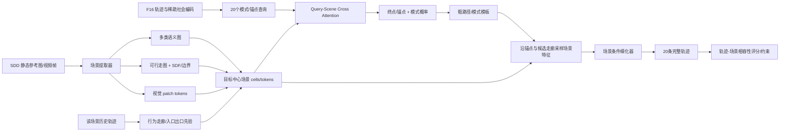

# 近四年场景信息提取与轨迹融合深度调研

> 检索日期：2026-08-28  
> 时间范围：2022-01-01—2026-08-28（按公开/正式发表年份纳入 2022—2026）  
> 任务对象：行人轨迹预测，重点面向 SDD；同时纳入自动驾驶运动预测、视觉基础模型和人群仿真中可迁移的方法。  
> 当前模型参照：F16 稀疏时间—社会交叉注意力 + 运动学稀疏图 + Kinematic K20 / 锚点—模式—细化候选体系。  
> 本阶段约束：暂不以参数量、FLOPs 或实时性筛选方法，优先判断信息价值和融合机制上限。

---

## 1. 调研口径与证据边界

### 1.1 “场景信息”在本报告中的定义

本报告不把“其他行人的历史轨迹”简单等同于场景信息，而将可影响未来路径的上下文分成六层：

1. **静态几何**：可行走/不可行走区域、建筑、树木、围栏、道路边界、狭窄通道；
2. **静态语义**：人行道、道路、草地、建筑、入口/出口、路口、兴趣点等类别；
3. **目标相对几何**：场景像素相对目标行人的距离、方向、航向夹角、边界法向；
4. **拓扑与路径结构**：通道中心线、分叉、连接关系、入口—出口和候选路径走廊；
5. **动态视觉环境**：临时障碍、车辆、自行车、信号、光照、群体、人体姿态/朝向；
6. **行为场**：由该场景历史轨迹学出的常用路线、吸引点、短期拥堵或临时行为走廊。

### 1.2 “所有”的实际含义

近四年相关论文跨越行人预测、车辆运动预测、图像分割、视觉语言和人群仿真，无法合理声称逐篇穷尽所有低影响论文。本报告采用的是：

- 系统覆盖主要输入表示与融合机制；
- 优先核查 CVPR、ICCV、ECCV、ICLR、NeurIPS、AAAI、WACV、ACCV 和重要期刊；
- 纳入可明显改变当前模型设计的代表性论文；
- 对仅有 arXiv 或相邻任务证据的工作单独降级标注；
- 自动驾驶方法只提取可迁移的“场景 token—轨迹 query”机制，不直接把车辆车道规则当作行人规则。

### 1.3 检索与核验

检索词围绕 pedestrian/human trajectory prediction、scene-aware、environment-aware、semantic map、walkability、goal/waypoint、map token、agent-map attention、trajectory refinement、visual foundation model 等展开。优先使用会议开放论文页、OpenReview、AAAI、Springer、Elsevier/PMC 和论文官方项目页，按标题、作者和 DOI 去重。

由于本次环境没有可调用的 Scopus/CrossRef/arXiv 聚合接口，未执行数据库级 PRISMA 计数和引文网络分析；因此这是一份**方法级深调研与设计报告**，不是可宣称“数据库穷尽”的系统综述。

---

## 2. 核心结论

### 2.1 最重要的五个判断

1. **显式空间语义通常比整图 RGB 向量更有效。** 2023 年 Semantic Scene Upgrades 在同一 VAE 骨干上表明，完整语义分割图明显优于 VGG 全局特征和压缩语义 embedding。场景信息的关键不是视觉 backbone 更大，而是坐标与语义没有被压扁。

2. **场景最应先影响“去哪”和“走哪一条路”，再影响局部细化。** MUSE-VAE、Goal-SAR、GSMNet、TSC-Net、VISTA 等都把目标/终点或中间位置放在完整轨迹之前。对当前锚点—模式体系，场景首先应改变模式概率、终点/锚点位置和路径分叉，不应只在历史编码后拼接一个向量。

3. **目标中心对齐是防止场景分支失效的关键。** UEN 的极坐标图、TSC-Net 的轨迹—场景 cell、QCNet/HiVT 的局部坐标和相对位置编码共同说明：模型必须知道“某个场景元素相对当前行人在哪里、沿其运动方向是什么关系”。

4. **一次融合不够。** 最有潜力的是分层融合：全局/中尺度场景用于目标与模式；候选走廊附近的局部场景用于锚点和逐步路径；完整轨迹上的可行走性用于评分或损失。Wayformer、MGSU、TSC-Net、HPNet、SmartRefine、LAformer 分别从不同任务支持这一点。

5. **当前模型最适合的不是 ASTRA 式单一 U-Net latent 拼接，而是“场景 cell/token + 候选走廊采样”。** 这既保留现有稀疏社会图和运动学先验，又能直击当前 SDD 的终点覆盖、复杂分叉、`little` 尺度和候选排序问题。

### 2.2 推荐的目标结构



这一路线不是用场景替代运动学，而是让场景回答运动学无法回答的问题：道路在何处转弯、哪一个分叉可通行、入口在哪里、某种运动模板在当前局部是否合理。

---

## 3. 适合引入的场景信息

| 场景信息 | 推荐表示 | 对当前模型解决什么 | 证据与判断 | 优先级 |
|---|---|---|---|---:|
| 可行走/不可行走区域 | 二值 mask + 概率图 | 防止候选穿越建筑、树、围栏；约束终点 | NSP、TrajDiffuse、SceneAware、W2W | A |
| 到不可行走边界的距离 | signed distance field（SDF）及梯度 | 比硬 mask 提供连续修正方向；适合细化和评分 | TrajDiffuse 的距离变换/梯度引导；本报告的任务化扩展 | A |
| 多类地面语义 | pavement/road/building/land/tree/other，另加 entrance/exit | 区分“能走”与“通常会走”；改善目标概率 | Semantic Scene Upgrades、UEN、MGSU、TSC-Net | A |
| 目标中心距离与方向 | 距离图、航向余弦/正弦图、相对坐标 | 解决全局图与局部轨迹错位 | UEN、HiVT、QCNet | A |
| 分叉与通道拓扑 | 骨架化中心线、节点/边、入口出口 token | 组织 20 个模式，使不同候选对应不同可行走分支 | MTR/MTR++、QCNet、ADAPT、HPNet 的地图迁移 | A |
| 候选走廊局部语义 | 在粗轨迹、锚点及其带状邻域采样 token | 判断同终点下哪条路径更合理；指导非锚点细化 | TSC-Net、LAformer、SmartRefine、MGSU | A |
| 场景历史行为密度 | 方向化 occupancy、route/corridor memory | 建模“实际常走路线”，补充静态语义看不见的偏好 | Latent Corridors；场景历史轨迹统计 | B |
| 入口、出口、兴趣点 | 点/区域 token + 类别 embedding | 形成目标吸引力与模式类别监督 | TSC-Net、UEN；EnvSocial-Diff 的 OOI | B |
| 原始视觉 patch 特征 | DINOv2/ViT 多尺度 tokens | 捕获分割标签以外纹理、阴影、细小物体 | MoST、SceneAware、视觉基础模型；需防止噪声 | B |
| 动态障碍与类别 | SAM2/检测/跟踪后的对象 mask、位置、速度 | SDD 中车辆、自行车与临时阻挡 | MoST、PTINet、EnvSocial-Diff；但与社会图需去重 | B |
| 姿态、朝向、视线、意图 | pose/heading/action token | 对起步、停留、过街等短期意图有效 | 多模态知识蒸馏、PTINet、视频 motion-scene disentanglement | C |
| 光照、天气、文本描述 | 全局条件或训练期 teacher | 临时行为变化和解释性 | EnvSocial-Diff、SceneAware、AutoTraces；对当前固定俯视 SDD 不是首轮重点 | C |

### 3.1 为什么推荐 SDF，而不只用硬可行走 mask

硬 mask 只告诉模型某个点是否违规，越界 1 像素与穿入建筑 50 像素可能得到相同标签。SDF 同时提供：

- 距离边界多远；
- 最短返回可行区域的方向；
- 候选是否沿边界稳定前进；
- 可微分的软惩罚和细化输入。

TrajDiffuse 已验证通过可导航图的距离变换与梯度修正扩散轨迹。即便当前不采用扩散模型，同样的连续场仍可输入锚点修正器、细化器和 scorer。

### 3.2 “行为走廊”与语义图不是同一种信息

语义图回答“哪里可以走”，行为走廊回答“这个场景里人通常怎样走”。例如广场全部可通行，但人群可能沿建筑边缘、斑马线或捷径形成窄分布。Latent Corridors 表明，用极少部署场景轨迹学习图像空间 prompt，可以捕获场景特定和临时行为。对 SDD，可先离线统计方向化轨迹密度，再决定是否学习 prompt。

---

## 4. 2022—2026 行人轨迹预测中的场景方法

### 4.1 直接相关、证据较强的方法

| 年份/论文 | 场景输入 | 提取方式 | 轨迹融合方式 | 对当前模型可借鉴部分 |
|---|---|---|---|---|
| 2022 MUSE-VAE（CVPR） | 语义图 + 轨迹热图 | 像素空间多尺度编码 | 宏观 CVAE 先生成长期目标与多个短期目标，微观 CVAE 再按目标生成轨迹 | 场景先约束终点/锚点，再生成完整路径；与两阶段解码高度一致 |
| 2022 Goal-SAR（CVPRW） | 图像/语义场景 | 场景只进入目标模块 | TTST 采样并聚类目标，目标通过 early/late/skip 方式条件化轨迹 | 可先只给 K20 的终点/模式头加入场景，建立低干扰基线 |
| 2022 Neural Social Physics（ECCV） | 可行走/不可行走分割 | 环境视野内的障碍区域 | 显式可学习环境排斥力进入神经微分方程 | 把 SDF 梯度作为软运动学场，而非把场景压成向量 |
| 2022 CSCNet（Pattern Recognition） | 场景/活动语义 | 上下文语义表示 | context-aware transfer 对齐社会与物理描述，并用条件上下文损失 | 增加“场景与轨迹是否匹配”的辅助监督，防止场景支路被忽略 |
| 2022/2023 MGSU | 局部 RGB/语义图 | 200×200 局部 crop；ESPNet/ADE20K | 粗场景融合 + trajectory-scene cross-attention + IRL 场景路径 + 细粒度路径融合 | 多尺度场景；轨迹查询场景；候选路径再次与场景融合 |
| 2023 Semantic Scene Upgrades | RGB、CNN embedding、语义 embedding、完整语义图 | VGG/PSP 等对照 | 同一 VAE 骨干中注入不同场景表示 | 直接证明显式完整语义优于全局 RGB/CNN embedding |
| 2024 UEN（AAAI） | 六类语义图、全体行人运动热图、目标极坐标图 | U-Net 类语义网络；距离/方向关系图 | 三类图在同一网格模态中经 CNN encoder-decoder 联合建模，随后预测 goal 和各时刻热图 | 最值得迁移的目标中心空间对齐；但无需复制整套热图网络 |
| 2024 Context-CVGN（Information Sciences） | BEV 语义图，含物理环境、行人及其他元素 | 语义 BEV 建模 | 作为 CVAE-GAN 条件，直接输出多模态轨迹及置信度 | 证明 BEV 语义可同时承载静态/动态环境；适合做统一 scene token 输入 |
| 2024 DTDNet | 局部场景与重要意图区域 | 粗/细粒度区域划分 | 场景区域评分辅助任务 + CVAE 轨迹生成 | 可把终点/锚点所在场景 cell 作为辅助分类标签，改善模式学习 |
| 2024 GSMNet（ACCV） | 全局目标、中尺度场景布局、邻居、局部运动 | attention U-Net + MLP | 按尺度分模块，最终融合多尺度特征预测轨迹 | 全局目标—中尺度路径—局部运动的分工正适合当前层级解码 |
| 2024 TrajDiffuse（ICPR） | 语义/可导航地图 | 二值可导航图 + 距离变换 | goal/waypoint 条件扩散；推理时地图梯度 guidance | 不必换扩散器，也可把地图能量用于轨迹细化和候选评分 |
| 2024 Latent Corridors（ECCV） | 场景图像 + 少量部署轨迹 | 每个场景可学习图像 prompt | 冻结/基本冻结预测器，仅调 scene prompt | 在 SDD 每个固定摄像机场景学习行为走廊，补充静态语义 |
| 2025 TSC-Net（ICLR） | 语义场景图 | trajectory cells、goal scene cells、step scene cells | cell-level self/cross attention；终点和每步均为 cell 分类 + offset 回归 | **最适合当前模型**：锚点/模式与局部场景 cell 对齐，避免全局向量错位 |
| 2025 SceneAware（arXiv，未同行评审） | 静态图像、二值 walkability | 冻结 ViT；训练期 MLLM 产生可行走 mask | 场景编码进 Transformer，并加显式可行走/碰撞损失 | 可借鉴“MLLM 仅离线制图”和 binary mask 约束；不宜把其数值当强证据 |
| 2025 Where Do You Go?（arXiv） | 增强后的图像和语义分割特征 | 图像增强 + semantic segmentation | 场景与稀疏社会图特征做 cross-attention，再用 TCN 预测 | 结构与当前稀疏图相近，支持独立 scene cross-attention 而非改社会图 |
| 2025 PTINet（TR-C） | 个体局部特征、标志/标线等全局视觉、光流 | 图像与 optical flow | 轨迹和意图多任务解码 | 对视频流场景，可把意图分类作为辅助；静态 SDD 首轮不必加入 |
| 2026 VISTA（WACV） | 场景条件 goal heatmap + 多行人 | goal embedding | 每个递归步骤用 cross-attention 融合目标与历史，再做 social-token attention | 证明目标条件和社会交互应反复耦合；可改为非自回归锚点级融合 |
| 2026 W2W（CVPR） | 轨迹/交互文本 + 场景语义 mask 的越界信息 | 程序化语义关系与 off-road 判定 | SFT 后以 ADE + off-road reward 做 PPO | 重点借鉴“优化目标直接包含越界惩罚”，不建议为此换成语言模型 |
| 2026 EnvSocial-Diff（ICLR， crowd simulation） | BEV、文本、障碍、兴趣点、光照 | 实体 crop+文本+位置，光照图 | 环境力、社会力、历史力条件化加速度扩散 | 提醒场景不只是障碍，还含吸引物和全局条件；适合作为远期扩展 |
| 2026 CoordConv endpoint/path model（IET ITS） | 二值可行走图 + 轨迹梯度热图 | 人工/预制 walkability；CoordConv | 场景既作为输入又作为终点采样 mask，终点和完整轨迹热图并行预测 | 支持绝对坐标对齐、终点 mask 和非自回归全轨迹输出 |

### 4.2 从直接行人论文得到的共同模式

- **全局 RGB embedding 是最容易失效的融合。** 它丢失“入口在目标左前方还是右后方”的对应关系。
- **热图方法空间对齐好，但每个行人一套高分辨率 tensor 会使社会交互昂贵。** TSC-Net 的 cell 化与 UEN 的目标极坐标分别提供了替代方式。
- **只在最终损失惩罚越界不足以改善多模态覆盖。** 场景还应在生成前改变目标、锚点和模式分配。
- **只用硬 mask 会错过可行区域内部的行为偏好。** 因此需要多类语义或行为走廊。
- **场景辅助监督通常是增益放大器，不是完整主干。** DTDNet 的区域评分增益有限，但它能使场景特征获得明确任务。

---

## 5. 自动驾驶运动预测中可迁移的场景融合

自动驾驶的 HD map 比 SDD 语义图结构更完整，但其 token 化、相对位置和 query 融合机制对行人分叉路径非常有价值。

| 年份/论文 | 原任务中的地图/场景表示 | 融合机制 | 对行人模型的迁移方式 |
|---|---|---|---|
| 2022 Scene Transformer（ICLR） | 整个场景的 agents/map 上下文 | 场景中心联合 token 建模与 masking query | 将场景作为集合，而非单个向量；不必复制全局密集注意力 |
| 2022 HiVT（CVPR） | 矢量化地图 polyline | 局部上下文 + 全局交互；相对、旋转不变表示 | 把 SDD 可行走骨架/边界矢量化，按目标航向编码 |
| 2022 MTR（NeurIPS） | agent/map tokens | 带空间意图先验的 motion queries；全局意图定位 + 局部运动细化 | 让 K20 query 对应“场景分叉/目标区域 × 运动模式”，再细化 |
| 2023 MTR++ | 对称场景建模 | guided intention querying、定制化意图查询 | 从场景 goal cells 生成 query，而非所有场景共享固定身份 |
| 2023 Wayformer（ICRA） | 道路几何、连接、信号、agent history | 系统比较 early/late/hierarchical fusion；early fusion 最强 | 说明多模态充分交互上限高；但当前应保留分层对照以便归因 |
| 2023 QCNet（CVPR） | map polygon 与 agent states | query-centric 局部坐标；anchor-free proposal + anchor-based refinement | 将每个候选锚点作为局部 query，采样其附近 scene cells |
| 2023 ADAPT（ICCV） | agent/lane polylines | agent-agent、lane-lane、agent-lane、lane-agent 分关系注意力；终点后轨迹 | 明确区分社会图与场景图，只在接口处交叉，不把两者混成一张图 |
| 2023 ProphNet（CVPR） | road graph、历史、交互 | agent-centric scene；scene-derived anchor；anchor-informed proposal | 场景生成/调整锚点，现有运动学锚点作为先验而非最终固定点 |
| 2023 HPTR | 异构 polyline | relative pose encoding、异步分层更新 | 场景 token 低频更新，agent token 高频更新；适合多尺度场景 |
| 2023 MotionLM（ICCV） | road graph、信号、agent history | decoder motion tokens cross-attend scene encoding | 与当前 mode query → scene cross-attention 直接对应 |
| 2023 MotionDiffuser（CVPR） | road graph 与上下文 | scene cross-attention + 可微测试时 guidance cost | 场景相容性能量可作为候选后验，不依赖扩散结构 |
| 2024 MoST（CVPR） | 道路图/agent/信号 + 原始传感器视觉 | 基础视觉模型和 LiDAR 网络产生开放词汇 scene tokens，trajectory queries 融合 | 语义 token 与视觉 token 并存，不把大图压成一个向量 |
| 2024 HPNet（CVPR） | lane segment tokens | mode query 分别对 lane nodes 和 agent history 做空间/时间 cross-attention | 当前 K20 每个模式分别读取场景和社会历史，再融合 |
| 2024 SmartRefine（CVPR） | 道路与 agent context | 粗轨迹决定关键上下文，按质量分数迭代细化 | 先有候选再查其走廊附近场景，最适合现有细化器 |
| 2024 LAformer（CVPRW） | lane-aware likelihood | 各未来时刻密集对齐道路约束；两阶段轨迹细化 | 在 12 个未来步采样 scene likelihood，直接修正同终点不同路径 |
| 2025 Trajectory Mamba（CVPR） | 静态/动态 polyline | cross-state-space attention 在解码期共享 scene context | 若以后场景 token 很长，可替代密集 attention；当前先看信息收益 |
| 2025 SATP（CVPR） | SD + HD map | 多分辨率地图融合与对齐 | SDD 可融合全局低分辨率拓扑和局部高分辨率语义 |
| 2025 PerReg+（CVPR） | 轨迹段与 lane 段 | masked reconstruction、register query、adaptive prompt | 可对场景 token 做遮挡重建/场景 prompt，提升跨场景泛化 |

### 5.1 对当前结构最有价值的三条迁移

1. **MTR/HPNet：mode query 必须有空间意图。** 当前 20 个模式不应只对应固定运动学偏移或自由 embedding，还应对应当前场景的目标区域、路径分叉或走廊。
2. **QCNet/SmartRefine：候选决定它该看哪里。** 对每条粗轨迹，在其锚点和走廊附近采样不同的 scene tokens，避免所有候选共享同一场景向量。
3. **ADAPT：社会交互与场景交互是不同关系。** 保留 F16 的 agent-agent 稀疏图，另建 agent/mode-to-scene cross-attention，最后在候选层融合。

---

## 6. 近四年的场景提取器选择

轨迹预测论文中的 ESPNet、PSPNet、U-Net 已能生成语义图，但 2022—2025 的视觉方法提供了更强的离线制图工具。由于 SDD 摄像机固定，本阶段完全可以把大型提取器视为离线标注/特征生成器。

| 方法 | 年份/出处 | 能得到什么 | 对 SDD 的合理用途 | 注意事项 |
|---|---|---|---|---|
| Mask2Former | CVPR 2022 | semantic/instance/panoptic segmentation | 生成稳定多类语义底图 | 预训练类别未必细分校园入口/草地，需要少量校正 |
| OneFormer | CVPR 2023 | 单模型多任务 segmentation | 同时获得 stuff 语义和实例区域 | 适合离线统一生成语义与对象层 |
| Segment Anything（SAM） | ICCV 2023 | promptable class-agnostic masks | 快速描出道路、草地、建筑、围栏边界 | SAM 给 mask 不给可靠语义类别，必须配合人工或文本检测器 |
| SegGPT | ICCV 2023 | in-context/few-shot segmentation | 用少数 SDD 手工示例迁移到其余固定场景 | 适合类别定义特殊、标注量小的校园图像 |
| DINOv2 | TMLR 2024 | 自监督 dense visual features | 生成保留纹理与对象语义的 patch tokens，与显式语义并用 | 不应只取 CLS 全局向量；应保留空间 patch |
| Grounding DINO | ECCV 2024 | 文本开放集目标检测 | 用“entrance, bicycle rack, gate, parked vehicle”等文本找兴趣物 | 检测框还需 SAM/分割细化 |
| CAT-Seg | CVPR 2024 | 开放词汇逐像素语义 | 直接按自定义 SDD 类别文本生成语义图 | 类别相近时需人工抽检和置信度图 |
| SAM 2 | ICLR 2025 | 图像/视频 promptable segmentation + streaming memory | 从视频传播临时障碍、车辆和区域 mask | 只有需要时变场景时才优于单参考图 |

### 6.1 推荐的离线提取流程

首轮不需要训练端到端视觉分支，可按以下方式准备输入：

1. 每个 SDD `scene/video` 选择无严重遮挡的参考帧；
2. 用 OneFormer/Mask2Former 或 CAT-Seg 生成多类语义；
3. 用 Grounding DINO + SAM 补充入口、围栏、自行车架、停车区域等开放词汇对象；
4. 人工快速校正固定摄像机底图，形成高可信 6—10 类 map；
5. 合并为 walkability probability，并计算 SDF、边界梯度与骨架图；
6. 从训练轨迹生成方向化行为密度和入口—出口转移统计；
7. 同时离线缓存 DINOv2 patch tokens，留给后续“显式语义 vs 视觉特征”对照。

对于固定摄像机，**场景输入本质上仍来源于图片**，但大模型只需离线运行一次；在线轨迹模型可直接读取语义图、几何场和缓存 token。若要表达临时车辆、光照或施工变化，才需要视频流和 SAM2/检测跟踪。

---

## 7. 场景与轨迹的融合方法全分类

### 7.1 早期拼接/共同栅格

做法：把语义图、轨迹热图、社会 occupancy 在通道维拼接，统一由 CNN/U-Net 编码。

- 代表：MUSE-VAE、UEN、GSMNet、Y-Net 系方法；
- 优点：空间对齐直接，适合目标热图；
- 缺点：每个行人都需大 tensor，社会交互与轨迹序列结构容易被栅格化稀释；
- 当前用途：可作为高上限热图基线，不宜直接成为主模型唯一融合。

### 7.2 全局向量的 late fusion

做法：整图 CNN/ViT pooling 后与轨迹 embedding 拼接或门控相加。

- 代表：大量早期 CNN scene encoder；Semantic Scene Upgrades 的 VGG/embedding 对照；
- 优点：实现简单；
- 缺点：位置对应关系丢失，所有候选获得同一场景信息；
- 当前判断：**只适合作为最低基线，不是推荐主线。**

### 7.3 目标中心局部裁剪与极坐标融合

做法：以最后观测点为中心、按航向旋转，构造局部语义或距离/方向图。

- 代表：MGSU 局部 crop、UEN polar maps、HiVT/QCNet 相对局部坐标；
- 优点：尺度和方位明确；
- 缺点：裁剪太小会看不到远目标，太大则局部精度下降；
- 当前用途：同时保留一个中尺度 agent-centric crop 和低分辨率全局 topology。

### 7.4 Agent/Mode-to-Scene Cross-Attention

做法：场景保留为 cells、patches 或 polylines；行人/模式 query 主动检索相关场景 token。

- 代表：MGSU、TSC-Net、ADAPT、MotionLM、MoST、HPNet；
- 优点：保持空间 token，不破坏 F16 社会编码；每个模式可看不同区域；
- 缺点：必须设计相对位置 bias 和候选相关 mask，否则会退化成全局噪声；
- 当前判断：**主融合机制首选。**

### 7.5 目标/锚点条件化融合

做法：先预测 goal/waypoints，再让轨迹模块读取这些目标与场景。

- 代表：MUSE-VAE、Goal-SAR、GSMNet、TSC-Net、VISTA、MTR；
- 优点：直接缓解多模态平均和终点—路径冲突；
- 当前用途：scene-conditioned anchor/mode proposals，再由模式模板生成完整轨迹。

### 7.6 候选走廊/逐时刻采样

做法：先有粗轨迹，然后在每个未来点或带状邻域从场景特征图采样，预测修正量。

- 代表：TSC-Net step cells、MGSU 细粒度路径、SmartRefine、LAformer；
- 优点：能区分“终点相同、路径不同”的候选，正对当前 ADE/FDE 分离问题；
- 当前判断：**细化器改造首选。**

### 7.7 场景能量、损失与推理引导

做法：对越界、碰撞、逆向或低概率区域施加 loss/reward/gradient guidance。

- 代表：CSCNet、NSP、MotionDiffuser、TrajDiffuse、SceneAware、W2W；
- 优点：结构可插拔，明确保证场景分支被利用；
- 风险：过强硬约束会惩罚真实的草地穿行或异常行为；
- 当前用途：使用概率语义与 soft margin，作为生成和评分的补充，而非唯一场景机制。

### 7.8 场景 prompt、蒸馏与隐式记忆

做法：用图像 prompt、register、teacher 或场景历史形成可学习先验。

- 代表：Latent Corridors、PerReg+、多模态知识蒸馏、SceneAware；
- 优点：适应固定摄像机与临时行为；
- 当前用途：在显式语义基线有效后，增加每个 SDD 场景的行为 prompt。

---

## 8. 针对当前模型的具体设计

### 8.1 场景输入张量

建议每个固定场景预计算：

```text
SceneRaster = [
  walkability_probability,
  signed_distance_to_obstacle,
  boundary_gradient_x, boundary_gradient_y,
  semantic_one_hot(6~10 classes),
  behavior_density,
  behavior_direction_x, behavior_direction_y
]
```

对每个目标行人，再动态加入：

```text
AgentRelative = [
  relative_x, relative_y,
  distance,
  cos(relative_angle_to_heading),
  sin(relative_angle_to_heading)
]
```

并保留可选的 DINOv2/ViT patch tokens。这样既有显式可解释几何，也保留视觉基础模型无法压缩到少数人工类别的细节。

### 8.2 场景 token 的两级组织

1. **全局/中尺度 goal cells**：覆盖目标可能到达的区域，低分辨率，提供终点、分叉和入口候选；
2. **局部 corridor cells**：围绕每个候选的锚点与粗轨迹采样，高分辨率，提供路径细化和相容性。

每个 token 至少包含语义 embedding、SDF、行为密度、相对目标位置和尺度层级。这样可综合 TSC-Net 的 cell 对齐、UEN 的目标相对几何、MTR 的意图 query 和 SmartRefine 的候选驱动上下文。

### 8.3 与 K20/锚点—模式的融合

对第 `k` 个 mode：

1. 由现有 F16 编码得到运动/社会上下文 `h_i`；
2. 用 mode query `q_k` 与候选运动学先验形成初始查询；
3. `q_k` 对 goal cells 做 cross-attention，输出场景条件的终点/锚点修正和模式 logit；
4. 将修正后的锚点与 mode template 组成粗轨迹；
5. 沿粗轨迹采样 corridor cells；
6. 细化器一次性输出 12 步残差，而非用场景插值生成轨迹；
7. scorer 读取完整候选、F16 社会上下文、沿途 SDF/语义/行为似然，输出 scene compatibility。

这会保留用户提出的“锚点 + 运动模式作为模板，解码器输出相对模板的变化量”，并使场景决定模板在当前空间如何落地。

### 8.4 训练目标

建议总损失分为：

```text
L = L_trajectory
  + λ_goal      * L_goal_cell_and_offset
  + λ_anchor    * L_anchor_cell_and_offset
  + λ_scene     * L_soft_walkability
  + λ_corridor  * L_corridor_alignment
  + λ_mode      * L_scene_conditioned_mode_group
  + λ_rank      * L_candidate_scene_ranking
  + λ_use       * L_scene_usage
```

- `L_goal_cell_and_offset`：TSC-Net 式区域分类 + 亚 cell 偏移；
- `L_soft_walkability`：在预测点采样不可行走概率/SDF，不用绝对硬禁止；
- `L_corridor_alignment`：整条候选与语义/行为走廊的一致性；
- `L_scene_conditioned_mode_group`：让相似路径拓扑落入同组，同时区分左右分叉/不同入口；
- `L_candidate_scene_ranking`：相同历史下，低越界且接近真值的候选得分更高；
- `L_scene_usage`：将正确场景与打乱场景形成对比，或使用 context-blind teacher，防止模型完全忽略场景。

### 8.5 为什么场景能缓解 ADE/FDE 候选冲突

当前终点最优候选与整条路径最优候选经常不同，是因为终点只限制最终坐标，而中段形态仍可走错分叉、转弯时机或通道。场景提供了两类额外判据：

- **终点层**：入口、出口、可达目标区域决定 FDE 候选；
- **路径层**：从当前位置到终点的可行走拓扑和行为走廊决定 ADE 候选。

当 mode query 同时绑定目标 cell 和路径 corridor，同一个候选才更可能同时拥有较好 ADE 与 FDE。仅在最终轨迹后加 off-road loss，无法完整完成这种绑定。

---

## 9. 建议的实验链

下面按“信息价值与因果可解释性”排序，不按计算开销排序。每个版本应建立独立目录、配置、原始结果和分析文件。

### 第一阶段：确认什么场景信息真正有效

| 实验 | 唯一主要变化 | 目的 |
|---|---|---|
| SC-0 | 当前 SDD 模型，无场景 | 严格基线 |
| SC-1 | 二值 walkability + SDF，仅输入 scorer/soft loss | 判断可行性约束能否改善排序与违规率 |
| SC-2 | 6—10 类显式语义 + SDF，agent-centric crop 门控到共享编码 | 检验普通 late fusion；预期只是下限 |
| SC-3 | DINOv2 patch tokens 代替显式语义，保持同一融合点 | 比较隐式视觉与显式语义 |
| SC-4 | 显式语义 + DINOv2 tokens | 判断互补性 |
| SC-shuffle | 对 SC-2/4 打乱场景—轨迹配对 | 排除“只是多参数/正则化”的假提升 |

### 第二阶段：让场景进入终点和模式生成

| 实验 | 修改 | 主要来源 |
|---|---|---|
| SF-1 | TSC goal cells：终点 cell 分类 + offset，K=20 采样/分配 | TSC-Net |
| SF-2 | K20 mode queries → scene goal cells cross-attention | MTR、HPNet、MotionLM |
| SF-3 | 加 UEN 式目标中心距离/方向通道 | UEN、QCNet |
| SF-4 | 将 mode 辅助类别改为“目标区域 × 路径分叉组” | TSC-Net、MTR++，结合当前模式分组设想 |

第一项判定目标不是只降低 off-road，而是 minFDE 与 minADE 同时改善。若 SF-2 只改善 Top-1、不改善 Oracle，说明场景只进入了 scorer，没有真正改变候选覆盖。

### 第三阶段：候选走廊和细化

| 实验 | 修改 | 主要来源 |
|---|---|---|
| SR-1 | 在 2/4/6 个锚点处采样局部 scene cells，条件化一次性残差细化 | TSC-Net step cells |
| SR-2 | 沿 12 步粗轨迹做带状 corridor sampling | LAformer |
| SR-3 | 先按粗轨迹质量选取关键场景 token，再迭代一次细化 | SmartRefine |
| SR-4 | 显式行为走廊/方向密度加入 corridor tokens | Latent Corridors 的任务化改写 |

这里应同时报告 minADE、same-path FDE 和 minFDE。若 minFDE 改善而 same-path FDE/ADE 不变，说明仍只是终点调整；若 same-path FDE 和 ADE 同步改善，才说明路径融合成功。

### 第四阶段：场景使用与泛化

| 实验 | 修改 | 目的 |
|---|---|---|
| SG-1 | scene-shuffle 对比损失或 context-blind 辅助模型 | 强迫网络使用场景 |
| SG-2 | masked scene token reconstruction | 提升局部遮挡与跨场景表征 |
| SG-3 | 每个摄像机/时段 latent corridor prompt | 学习场景特有行为 |
| SG-4 | 视频动态 mask、车辆/自行车 token、光流/姿态 | 只有静态场景主线有效后再做动态扩展 |

---

## 10. 评价指标与必要诊断

除了 minADE20/minFDE20，必须增加：

- same-path FDE；
- Top-1 ADE/FDE、best-candidate 命中率和 selection regret；
- off-road/obstacle violation rate；
- 轨迹落在高概率行为走廊内的比例；
- 终点 cell recall@K；
- 路径分叉/模式组分类准确率；
- 场景打乱后的性能下降；
- 直行、转弯、分叉、入口、开阔区、狭窄通道分组；
- `little` 与其他 SDD 场景分组；
- 不同相机像素—米尺度下的分组结果。

最关键的防伪诊断是：**正确场景显著优于打乱场景**。如果正确场景与错误场景几乎相同，说明分支虽存在但模型没有真正使用它。

---

## 11. 不建议作为第一轮主线的方法

1. **整张 RGB → 单个 CNN/ViT 向量 → 与 agent embedding 拼接。** 空间错位明显，且已有对照说明收益可能很小甚至伤害 FDE。
2. **直接把所有像素 token 放进现有 agent-agent 稀疏注意力。** 会混淆社会关系和场景关系，也破坏现有 F16 的已验证结构。
3. **只加硬可行走 mask。** 能减少违规，但对开阔区域内的路径偏好和多模态分叉帮助不足。
4. **一开始就换成 diffusion/LLM/VLM 解码器。** TrajDiffuse、W2W、AutoTraces 的价值主要在场景 guidance、奖励和语义表示，不等于当前模型必须更换生成范式。
5. **只在最终 scorer 加场景。** 这可能改善 Top-1，却不能改善 minADE/minFDE 候选覆盖；场景必须进入 mode/anchor generation。
6. **把真实路径严格限制在人工语义图。** SDD 中草地穿行、标注误差和临时通道真实存在，应使用概率/软约束。

---

## 12. 最终优先级

### P0：先完成高可信场景底图

多类语义 + walkability probability + SDF + 目标相对几何 + 摄像机尺度校准。没有可靠空间对齐，后续任何视觉分支都会把标注/尺度误差当作模型问题。

### P1：TSC goal cells + mode-to-scene cross-attention

这是最可能首先改善 minFDE 和模式分叉覆盖的结构。它不要求立即重写完整解码器，可以保留现有 K20/模式模板和 F16 社会编码。

### P2：候选走廊条件细化

在粗锚点/模板生成后，沿候选路径采样 scene cells，一次性预测非锚点残差。它最直接解决“终点最好与整条路径最好不是同一候选”的问题。

### P3：scene compatibility + scene-usage supervision

用 SDF/语义/行为走廊训练候选评分，并加入 scene shuffle/context-blind 对照，确保模型确实利用场景。

### P4：行为走廊与视觉 token

当显式语义链条成立后，再加入每个 SDD 场景的历史行为 prompt 和 DINOv2/MoST 式视觉 tokens，以捕获人工类别外的信息。

### P5：视频动态场景

最后考虑 SAM2、光流、姿态、车辆/自行车和临时障碍。固定参考图已经能覆盖 SDD 大部分静态几何价值，视频流应作为增量而不是起点。

---

## 13. 主要来源

### 行人轨迹与环境建模

- [MUSE-VAE, CVPR 2022](https://openaccess.thecvf.com/content/CVPR2022/html/Lee_MUSE-VAE_Multi-Scale_VAE_for_Environment-Aware_Long_Term_Trajectory_Prediction_CVPR_2022_paper.html)
- [Goal-SAR, CVPRW 2022](https://piurilabs.di.unimi.it/Papers/cvprw2022.pdf)
- [Human Trajectory Prediction via Neural Social Physics, ECCV 2022](https://www.ecva.net/papers/eccv_2022/papers_ECCV/papers/136940368.pdf)
- [CSCNet, Pattern Recognition 2022](https://www.sciencedirect.com/science/article/pii/S0031320322000334)
- [MGSU](https://link.springer.com/article/10.1007/s40747-022-00834-2)
- [Semantic Scene Upgrades for Trajectory Prediction, 2023](https://pmc.ncbi.nlm.nih.gov/articles/PMC9870204/)
- [A Unified Environmental Network, AAAI 2024](https://ojs.aaai.org/index.php/AAAI/article/view/28301)
- [Context-CVGN, Information Sciences 2024](https://www.sciencedirect.com/science/article/pii/S0020025524003463)
- [DTDNet, 2024](https://www.frontiersin.org/journals/neuroscience/articles/10.3389/fnins.2024.1346374/full)
- [GSMNet, ACCV 2024](https://openaccess.thecvf.com/content/ACCV2024/html/Liu_GSMNet_Towards_Long-term_Trajectory_Prediction_by_Integrating_Multi-Scale_Information_ACCV_2024_paper.html)
- [TrajDiffuse, ICPR 2024](https://arxiv.org/abs/2410.10804)
- [Adaptive Human Trajectory Prediction via Latent Corridors, ECCV 2024](https://eccv.ecva.net/virtual/2024/poster/1737)
- [TSC-Net, ICLR 2025](https://proceedings.iclr.cc/paper_files/paper/2025/hash/2bf490f7cd34b98c99a62ef10b959adc-Abstract-Conference.html)
- [SceneAware, arXiv 2025](https://arxiv.org/abs/2506.14144)
- [Where Do You Go?, arXiv 2025](https://arxiv.org/abs/2501.13848)
- [PTINet, Transportation Research Part C 2025](https://doi.org/10.1016/j.trc.2025.105203)
- [VISTA, WACV 2026](https://openaccess.thecvf.com/content/WACV2026/html/Da_Silva_Martins_VISTA_A_Vision_and_Intent-Aware_Social_Attention_Framework_for_Multi-Agent_WACV_2026_paper.html)
- [W2W, CVPR 2026](https://openaccess.thecvf.com/content/CVPR2026/html/Xu_W2W_Language-Model-Based_Trajectory_Prediction_with_Reinforcement_Learning_CVPR_2026_paper.html)
- [EnvSocial-Diff, ICLR 2026](https://openreview.net/pdf?id=2XBAm3Dbnt)

### 自动驾驶地图与场景 token 融合

- [Scene Transformer, ICLR 2022](https://arxiv.org/abs/2106.08417)
- [HiVT, CVPR 2022](https://openaccess.thecvf.com/content/CVPR2022/html/Zhou_HiVT_Hierarchical_Vector_Transformer_for_Multi-Agent_Motion_Prediction_CVPR_2022_paper.html)
- [MTR, NeurIPS 2022](https://papers.neurips.cc/paper_files/paper/2022/hash/2ab47c960bfee4f86dfc362f26ad066a-Abstract-Conference.html)
- [MTR++](https://arxiv.org/abs/2306.17770)
- [Wayformer](https://waymo.com/research/wayformer/)
- [QCNet, CVPR 2023](https://openaccess.thecvf.com/content/CVPR2023/html/Zhou_Query-Centric_Trajectory_Prediction_CVPR_2023_paper.html)
- [ADAPT, ICCV 2023](https://openaccess.thecvf.com/content/ICCV2023/html/Aydemir_ADAPT_Efficient_Multi-Agent_Trajectory_Prediction_With_Adaptation_ICCV_2023_paper.html)
- [ProphNet, CVPR 2023](https://openaccess.thecvf.com/content/CVPR2023/html/Wang_ProphNet_Efficient_Agent-Centric_Motion_Forecasting_With_Anchor-Informed_Proposals_CVPR_2023_paper.html)
- [MotionLM, ICCV 2023](https://openaccess.thecvf.com/content/ICCV2023/html/Seff_MotionLM_Multi-Agent_Motion_Forecasting_as_Language_Modeling_ICCV_2023_paper.html)
- [MotionDiffuser, CVPR 2023](https://openaccess.thecvf.com/content/CVPR2023/html/Jiang_MotionDiffuser_Controllable_Multi-Agent_Motion_Prediction_Using_Diffusion_CVPR_2023_paper.html)
- [MoST, CVPR 2024](https://openaccess.thecvf.com/content/CVPR2024/html/Mu_MoST_Multi-Modality_Scene_Tokenization_for_Motion_Prediction_CVPR_2024_paper.html)
- [HPNet, CVPR 2024](https://openaccess.thecvf.com/content/CVPR2024/html/Tang_HPNet_Dynamic_Trajectory_Forecasting_with_Historical_Prediction_Attention_CVPR_2024_paper.html)
- [SmartRefine, CVPR 2024](https://openaccess.thecvf.com/content/CVPR2024/html/Zhou_SmartRefine_A_Scenario-Adaptive_Refinement_Framework_for_Efficient_Motion_Prediction_CVPR_2024_paper.html)
- [LAformer, CVPRW 2024](https://openaccess.thecvf.com/content/CVPR2024W/MULA/html/Liu_LAformer_Trajectory_Prediction_for_Autonomous_Driving_with_Lane-Aware_Scene_Constraints_CVPRW_2024_paper.html)
- [Trajectory Mamba, CVPR 2025](https://openaccess.thecvf.com/content/CVPR2025/html/Huang_Trajectory_Mamba_Efficient_Attention-Mamba_Forecasting_Model_Based_on_Selective_SSM_CVPR_2025_paper.html)

### 场景提取与视觉基础模型

- [Mask2Former, CVPR 2022](https://openaccess.thecvf.com/content/CVPR2022/html/Cheng_Masked-Attention_Mask_Transformer_for_Universal_Image_Segmentation_CVPR_2022_paper.html)
- [OneFormer, CVPR 2023](https://openaccess.thecvf.com/content/CVPR2023/html/Jain_OneFormer_One_Transformer_To_Rule_Universal_Image_Segmentation_CVPR_2023_paper.html)
- [Segment Anything, ICCV 2023](https://openaccess.thecvf.com/content/ICCV2023/html/Kirillov_Segment_Anything_ICCV_2023_paper.html)
- [SegGPT, ICCV 2023](https://openaccess.thecvf.com/content/ICCV2023/html/Wang_SegGPT_Towards_Segmenting_Everything_in_Context_ICCV_2023_paper.html)
- [DINOv2, TMLR 2024](https://arxiv.org/abs/2304.07193)
- [Grounding DINO, ECCV 2024](https://www.ecva.net/papers/eccv_2024/papers_ECCV/papers/06319.pdf)
- [CAT-Seg, CVPR 2024](https://openaccess.thecvf.com/content/CVPR2024/html/Cho_CAT-Seg_Cost_Aggregation_for_Open-Vocabulary_Semantic_Segmentation_CVPR_2024_paper.html)
- [SAM 2, ICLR 2025](https://proceedings.iclr.cc/paper_files/paper/2025/file/45c1f6a8cbf2da59ebf2c802b4f742cd-Paper-Conference.pdf)

---

## 14. 一句话研究判断

> 对当前模型，最值得验证的场景路线不是“图像编码后拼接”，而是：**显式语义/SDF/行为走廊 → 目标中心 scene cells → K20 模式与终点 cross-attention → 候选走廊条件细化 → 场景相容性评分与软约束**。其中 TSC-Net 的 cell 对齐、UEN 的极坐标关系、MTR/HPNet 的意图 query 和 SmartRefine/LAformer 的候选走廊细化应组合成一条统一实验主线。
